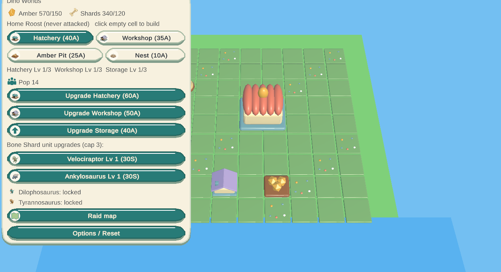
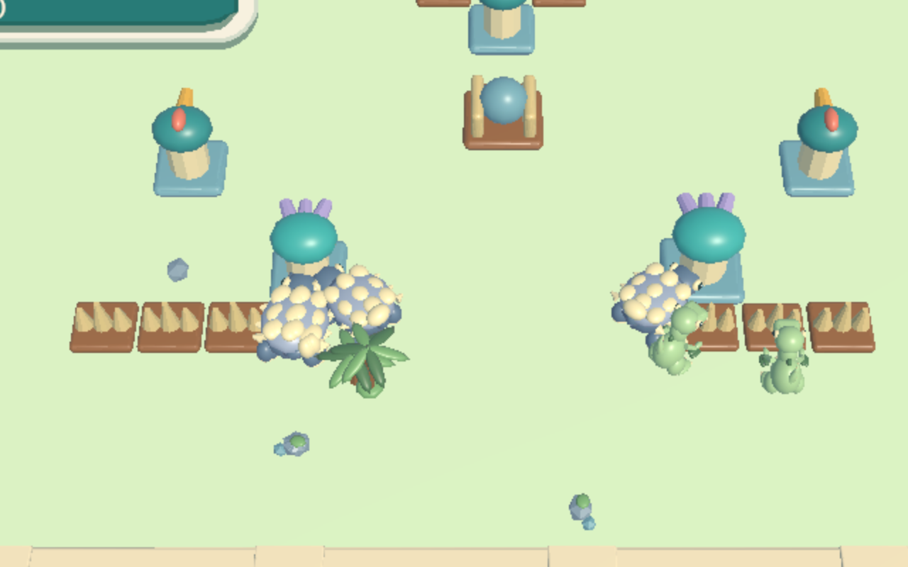

I asked the bot team for a small 3D raid game: build up a home roost, then send dinosaurs to take enemy islands. The result is **Dino Worlds**. Like [Astral Tide](/blog/astral-tide/), it's made in Unity and runs in your browser. All the art, music and sound are original.

**[Play Dino Worlds](https://mikenev.github.io/dino-worlds/)** · [Source on GitHub](https://github.com/mikenev/dino-worlds)

I count this one as a failure. That's not on the bots. For a while, something on xAI's side left them unable to make code changes the usual way, so we had to use Cursor instead. That stalled the project for days. The game that came out of it also feels like lower effort and lower quality than the other games on this site. But it is finished, and you can play it now.

## The game

Your Home Roost is never attacked. There you spend Amber to build and upgrade a Hatchery, a Workshop, an Amber Pit and Nests, and you spend Bone Shards to upgrade your dinosaurs. You start with the Velociraptor and the Ankylosaurus. Upgrade the Hatchery to unlock the Dilophosaurus, then the Tyrannosaurus.

From the roost you open a raid map of eight islands, in three bands: Shore, Ridge and Caldera. They unlock in order, starting with Shore Isle and ending at Ash Crown. On an island, you place crafts on the gold sand pads along the shore, load your dinosaurs onto them and start the raid. From there the fight runs on its own. You can pan and zoom, and you can pause or resume, but you don't give mid-battle orders. Win by destroying the island's Roost Heart. If your party falls, you can retry. Your progress is saved in the browser.

Options let you set music and effects volume, mute everything, and change the text size from 100% to 175%.

## A raid

Each island has its own layout of defenses: Peck Towers, Fan Spitters, Spike Hedges, Boulder Nests and a Roost Heart. Velociraptors swarm the nearest defense. Ankylosaurs tank and go after shooters first. Dilophosaurs hang back and spit. Tyrannosaurs smash buildings, especially the Heart.

| Action | Controls |
| :-- | :-- |
| Pan the camera | WASD, arrow keys, or right-drag |
| Zoom | Mouse wheel |
| Place a craft and load dinosaurs | Click a gold sand pad on the shore |
| Start the raid | Space, or the Start raid button |
| Pause or resume | Esc, or the Pause button |
| Options | O from the roost, or Options / Reset |

## How it was built

A team of AI bots built the game across five milestones. I directed it and gave notes along the way.

- **Lead Developer Bot** planned the milestones, handed out the work and merged each piece.
- **Game Dev Bot** built the game in Unity.
- **Art Dev** made the original art, including the animated dinosaurs and the island scenery.
- **Audio Dev** made the original music and sound effects.
- **QA Bot** tested every milestone.

The later milestones added durable saves, the options menu, animated dinosaurs (idle, walk and attack), real 3D scenery in place of simple shapes, wired-in UI icons, a pause button during fights, and gold sand pads so you can actually see where to deploy.

It's finished and playable. Give it a try and see how far you can raid.
