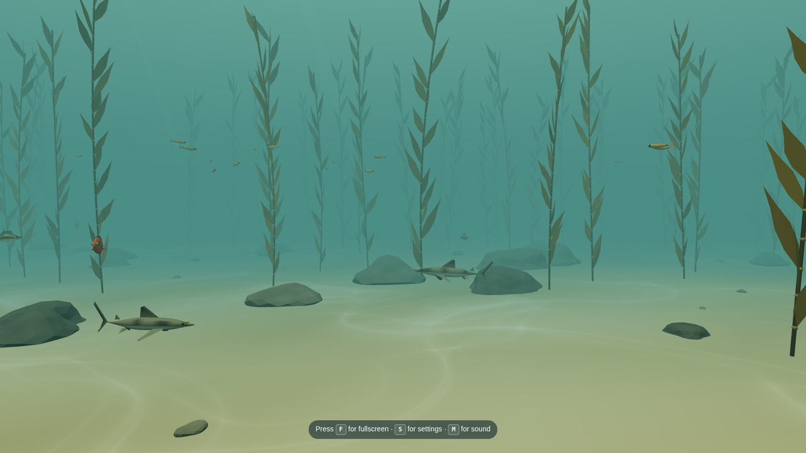
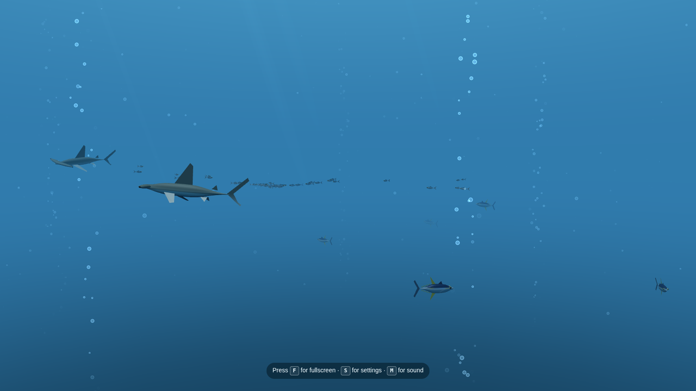
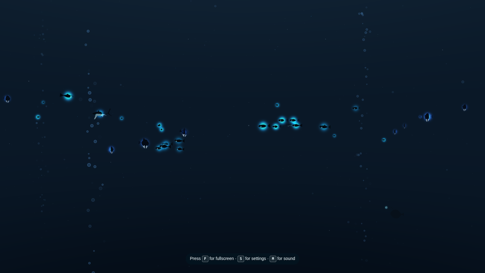

The bot team usually makes games, but this time I wanted something I could just leave open. The result is **Fathom**, a fullscreen aquarium that runs in your browser. It's built with Three.js, and the scenes and sound are all original.

**[Open Fathom](https://mikenev.github.io/fathom/)** · [Source on GitHub](https://github.com/mikenev/fathom)

## Four scenes

- **Tropical coral reef**: clownfish and blue tangs among branching and pillar corals, lyretail anthias in the midwater, and a blacktip reef shark cruising the edge.
- **Open ocean**: tight schools of Pacific sardines, yellowfin tuna, and scalloped hammerheads making slow loops through open blue water, with streams of bubbles rising through the light.
- **Kelp forest**: tall kelp over a sandy floor, bright orange garibaldi, señoritas and kelp bass among the stipes, and leopard sharks cruising the bottom.
- **Deep sea**: lanternfish and hatchetfish glowing in the dark, a footballfish wandering past, a velvet-belly lanternshark, and faint bubbles drifting up.

Each scene has its own ambient sound, synthesized live in the page, and its own slow camera drift. You can mute the sound, and the page remembers your settings.

## Controls

| Action | Controls |
| :-- | :-- |
| Fullscreen | F |
| Settings | S, or tap the Settings button |
| Close settings | Esc, or Back on a remote |
| Mute | M |
| Move through settings | Arrow keys, the D-pad, or the left stick |
| Change a setting | Left and Right, or Select / Enter |

On a phone or tablet, tap the screen for buttons to open settings, go fullscreen, switch scenes or mute the sound. A Fire TV remote and a gamepad work too: the D-pad or left stick moves through the panel, Select or A changes a setting, Back or B closes it, and Menu or Start opens settings. Add `?fps=1` to the link if you want to see the frame rate.

## How it was built

A team of AI bots built it across three milestones, plus a round of fixes I asked for after trying it: fish that swim more level, sharks with more life, a taller and more varied reef, and bubbles in the open ocean and the deep sea. I directed it and gave notes along the way.

- **Lead Developer Bot** planned the milestones, handed out the work and merged each piece.
- **Game Dev Bot** wrote the code, scenes and sound included.
- **QA Bot** tested every milestone.

Open it fullscreen and leave it running.
