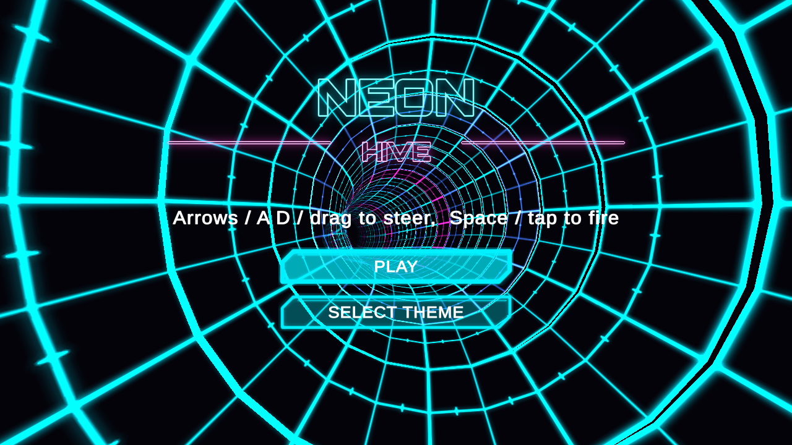
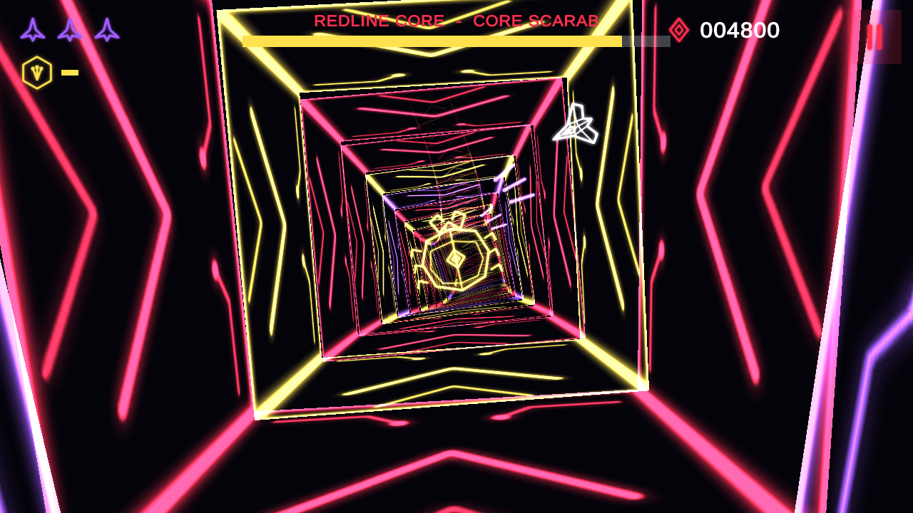

This time I wanted a fast arcade game, inspired by the classic tube shooters of the PlayStation era. The team built it as **Neon Hive**: you fly a small ship around the inside of a glowing tunnel and blast swarms of bugs. Like [Tidewatch](/blog/tidewatch/), it's made in Unity and runs in your browser, on a computer or a phone. All the art, music and sound are original.

**[Play Neon Hive](https://mikenev.github.io/neon-hive/)**

## The game

Your ship circles the inside wall of a neon tunnel that curves and twists as you fly. Bugs pour in from deep in the tunnel, and you slide around the wall to line up your shots.

There are four kinds of bugs:

- **Mites**
- **Wasps**
- **Spinners**, which shoot back
- **Beetles**, which are armored

Power-ups give you **Spread**, **Laser**, **Rapid** or **Homing** shots for 12 seconds each.

You get an extra life every 10,000 points. Your high score and the themes you've unlocked are saved in your browser.

## Three themes

There are 12 levels across three themes, and each one ends with a boss:

1. **Ion Drift:** a round tunnel with gentle curves. Boss: the Prism Moth.
2. **Acid Hive:** a hex-shaped tunnel. Boss: the Hive Queen.
3. **Redline Core:** a square tunnel with the wildest twists. Final boss: the Core Scarab.

Beat the Core Scarab and you get the **HIVE CLEARED** screen.

## Controls

| | Keyboard | Gamepad | Phone |
| :-- | :-- | :-- | :-- |
| Move around the tunnel | Arrows or A/D | Left stick | Drag |
| Fire | Space | A | Auto-fire while touching |
| Pause | Esc | Start | On-screen pause button |

## How it was built

Neon Hive was made by my team of AI bots:

- **Lead Developer Bot** planned the milestones, handed out the work and merged each piece.
- **Game Dev Bot** built the game.
- **Art Dev** made the original art.
- **Audio Dev** made the original music and sound effects.
- **QA Bot** tested the game.

Strap in, stay on the wall, and see if you can clear the hive!
